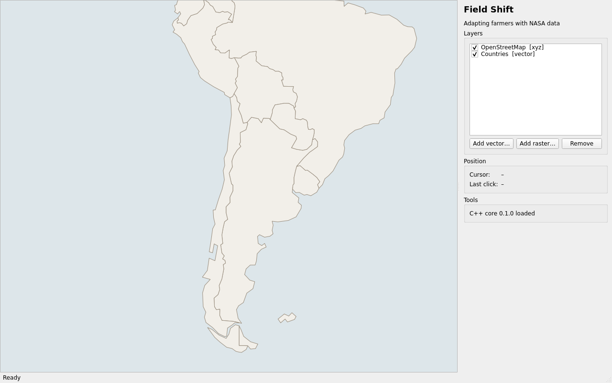
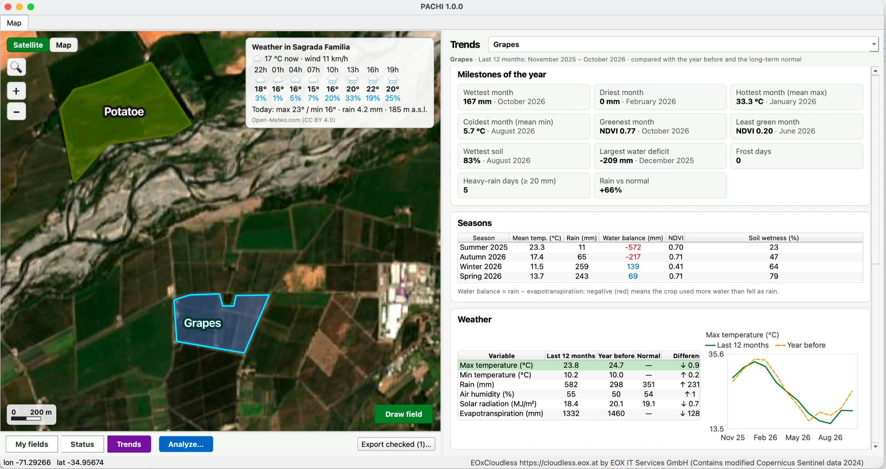
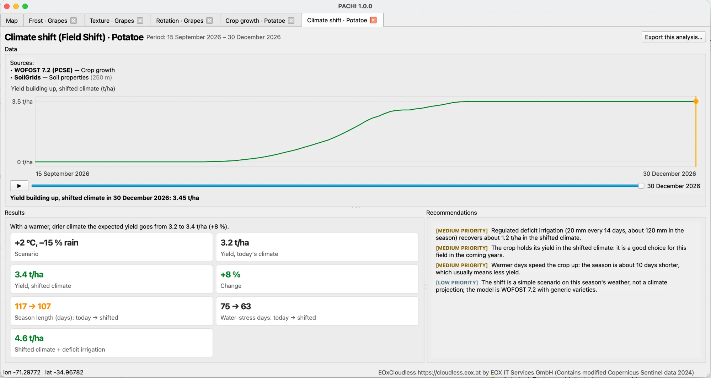
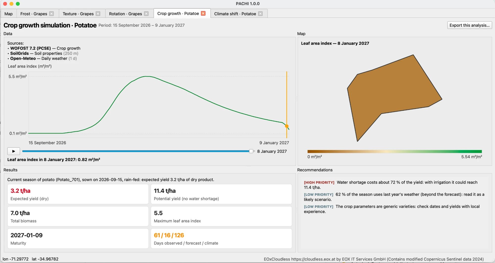
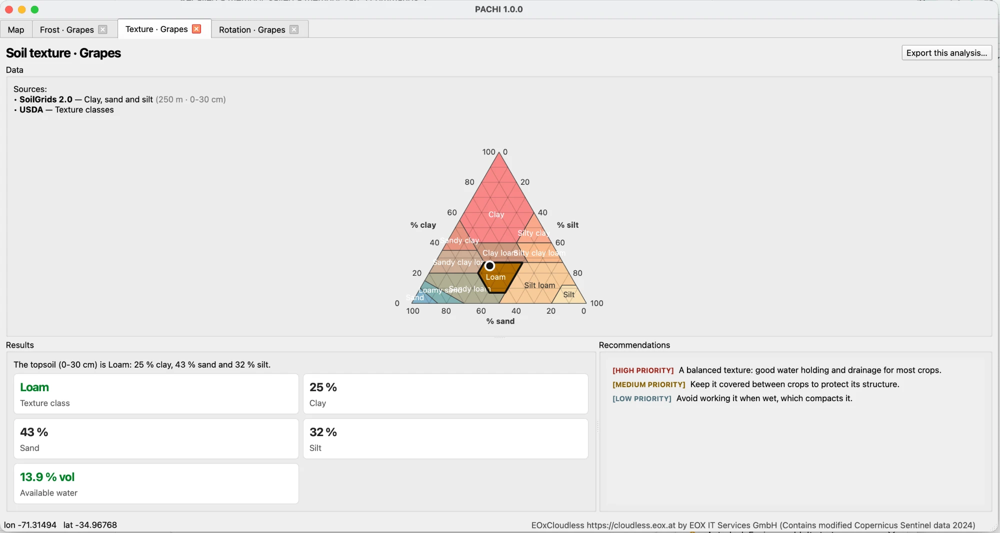
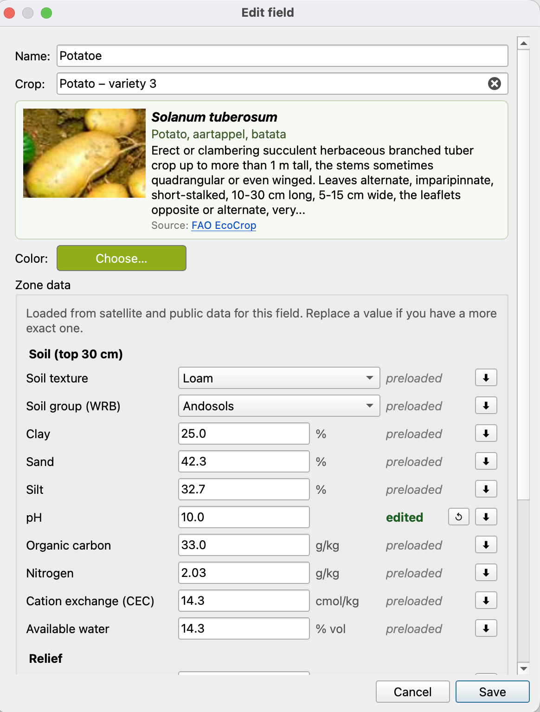
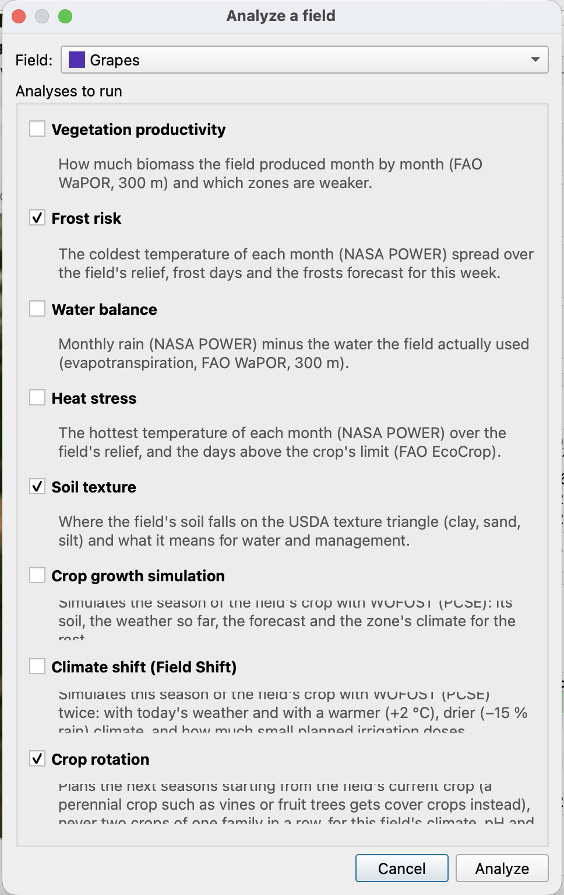
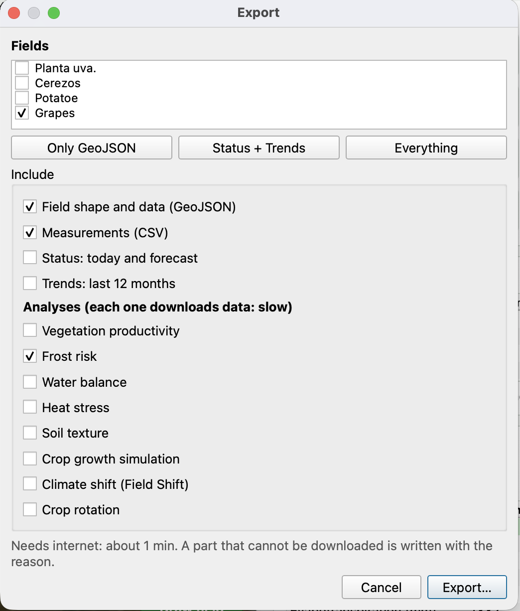

# NasaSpace-Apps-2026: PACHI

This is the official NASA Space Apps 2026 repository of the **Ursa Crux** rocketry
club (Pontificia Universidad Católica de Chile). It holds our solution to the
challenge **Field Shift: Adapting farmers with NASA data**.



**PACHI** helps a farmer adapt to a changing climate: draw your fields on a
satellite map and see, for each one, how it is **today**, how it behaved over
the **last year**, and **what to do next**, all from NASA and other open Earth
observation data, in English or Spanish.

## What it does

| | |
|---|---|
| **My fields** | Draw a field on the satellite map, name it and choose its crop (with Chilean cultivars such as Carménère, Lapins or Hass). Its soil, relief and vegetation load on their own; replace any value with your own measurement. |
| **Status** — *today and the coming days* | Today's weather, crop water use and top-soil water; the next 7 or 14 days with a chart per variable; light warnings (rain, frost, heat, wind, strong sun); and the crop's follow-up (newest NDVI image and its change). |
| **Trends** — *the last 12 months* | Milestones of the year (wettest and driest month, frosts, water deficit…), the seasons, and every variable against the year before and the long-term normal. |
| **Analyze** — *what to do next* | Vegetation, frost, water balance, heat stress, soil texture, crop growth (WOFOST), **climate shift** (+2 °C / −15 % rain, with deficit irrigation) and crop rotation; each with charts, a map of the field, metrics, a 3-month outlook and recommendations. |
| **Measurements** | Record probe readings, lab results, plant height, sowing, irrigation… with date and time. A measured value is used instead of the satellite one, and the app says so. |
| **Export** | One ZIP with a PDF report, the GeoJSON, CSV tables and the charts: of one analysis, or of several fields at once. |

When a data source cannot be reached, PACHI says why (no connection, timeout,
the service failed) and offers **Try again**; it never shows made-up numbers.

## Screenshots

| Status: today and the coming days | Trends: the last 12 months |
|---|---|
|  |  |

| Climate shift: today vs +2 °C / −15 % rain, and deficit irrigation | Crop growth simulation (WOFOST) |
|---|---|
|  |  |

| Analysis: frost risk with a 3-month outlook | Analysis: soil texture triangle |
|---|---|
|  |  |

| Field data | Choosing analyses | Export |
|---|---|---|
|  |  |  |

## Data sources

| Data | Source |
|---|---|
| Daily weather and climate normals, top-soil wetness | NASA POWER |
| Vegetation index (NDVI) | NASA MODIS MOD13Q1 (ORNL DAAC) |
| Weather now, hourly and the next 16 days | Open-Meteo (CC BY 4.0) |
| Biomass production and actual evapotranspiration | FAO WaPOR v3 |
| Soil properties | ISRIC SoilGrids 2.0 (CC BY 4.0) |
| Elevation and slope | Copernicus DEM |
| Crop requirements | FAO EcoCrop |
| Crop growth model | WOFOST 7.2 through PCSE |
| Satellite map | EOX Sentinel-2 cloudless (CC BY-NC-SA 4.0); street map © OpenStreetMap contributors |
| Place names | OpenStreetMap Nominatim |

## Download

Ready-to-run archives for **Windows and Linux** (everything inside, nothing to
install) are on the
[Releases page](https://github.com/UrsaCrux/NasaSpace-Apps-2026/releases):
unpack and double-click `FieldShift.bat` / `FieldShift.sh`. How they are built:
[docs/release.md](docs/release.md).

## Quick start (from the source)

```bash
# 1. install QGIS 4 with its Python bindings (see docs/README.md for your OS)
# 2. optional: build the C++ core
make cpp
# 3. run (English or Spanish)
make run                     # or: python3 -m fieldshift
make run LANG_UI=es
```

The crop growth and climate shift simulations need PCSE
(`python -m pip install pcse`, done by `make env`).

## Field data from code

```python
from fieldshift.api import get_site_data
site = get_site_data(lon=-71.0, lat=-34.5, radius_m=1500)
print(site.summary())      # soil type and properties, ET, elevation, weather, ...
```

See [docs/data-api.md](docs/data-api.md) for the sources and the free keys some
of them need.

## How it is built

PACHI is a Python desktop app on **QGIS 4 (Qt6)**: a map on the left, a panel on
the right. The map is hidden behind an abstraction layer (`fieldshift/map/`), so
features never call QGIS directly, and performance-critical code can be written
in C++ (`cpp/`) and called from Python.

```
fieldshift/            Python application
├── app.py             start-up: QgsApplication, default layers, window
├── map/               map abstraction layer (MapView, LayerSpec, Event)
├── ui/                main window, fields bar, Status / Trends panels, analysis tabs, dialogs
├── fields/            the user's fields (GeoJSON store, FieldsManager) and their measurements
├── status/            Status: today, forecast, warnings, crop follow-up
├── trends/            Trends: last 12 months, milestones, seasons
├── analysis/          the analyses of a field and their results
├── simulation/        WOFOST (PCSE) runs: weather, soil, climate shift scenarios
├── export/            ZIP export: PDF report, JSON, CSV, charts
├── crops/             crop catalogue, FAO EcoCrop data, WOFOST crop mapping, rotation roles
├── api/               get_site_data(lon, lat, radius), forecast, place search
│   └── providers/     one module per data source (SoilGrids, WaPOR, ERA5-Land, ...)
├── i18n/              user-visible texts per language (en.json, es.json)
└── native/            ctypes bindings for the C++ library
cpp/                   C++ functions callable from Python (CMake)
data/                  bundled datasets (offline country outlines)
terrenos/              the user's saved fields, one .geojson each (ignored by git)
packaging/             release builds (one archive per system)
docs/                  documentation, generated API reference in docs/api/
tools/minidoc_py.py    minidoc-style exporter for the Python code
tests/                 unit tests (python -m unittest)
```

## Documentation

Start at [docs/README.md](docs/README.md):
[architecture](docs/architecture.md) ·
[map abstraction layer](docs/map-abstraction.md) ·
[field data API](docs/data-api.md) ·
[Status and Trends](docs/status.md) ·
[analyses](docs/analysis.md) ·
[crop simulation](docs/simulation.md) ·
[export](docs/export.md) ·
[C++ functions](docs/cpp.md) ·
[documenting with minidoc](docs/minidoc.md) ·
[contributing](docs/contributing.md) ·
API reference: [Python](docs/api/PYTHON_API.md), [C++](docs/api/CPP_API.md).
