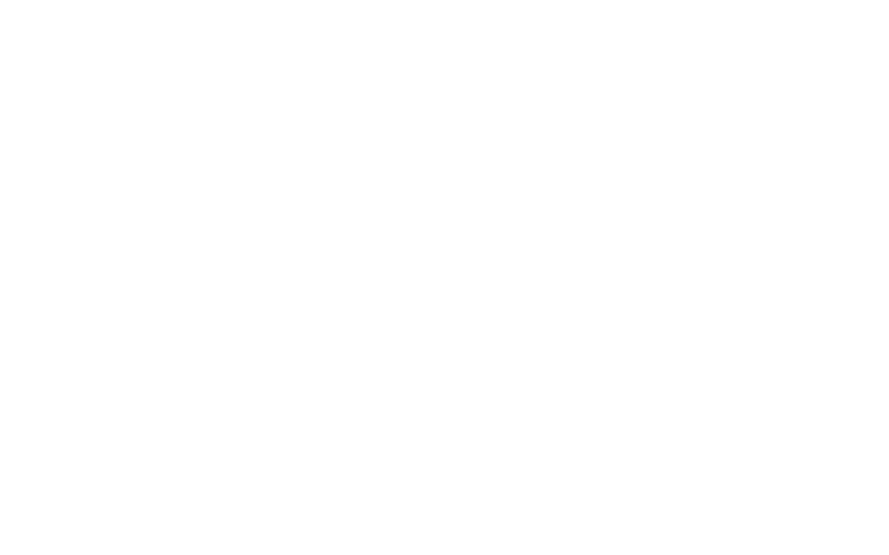

# NasaSpace-Apps-2026: PACHI
This is the official Nasa Space Apps 2026 Repository for the contributions of the Ursa Crux Rocketry club located in Pontificia Universidad Católica de Chile. This repository contains the solution to the challenge Field Shift: Adapting farmers with Nasa Data


| Field data | Analysis | Status and trends |
|---|---|---|
|  |  |  |

**PACHI** is a Python desktop app built on top of **QGIS 4 (Qt6)**: a map on the
left, a panel on the right. The map is hidden behind an abstraction layer
(`fieldshift/map/`), so new features never call QGIS directly, and
performance-critical code can be written in C++ (`cpp/`) and called from
Python.

## Download

Ready-to-run archives for **Windows and Linux** (everything inside,
nothing to install) are on the
[Releases page](https://github.com/UrsaCrux/NasaSpace-Apps-2026/releases):
unpack and double-click `FieldShift.bat` / `FieldShift.sh`. How they are built: [docs/release.md](docs/release.md).

## Quick start

```bash
# 1. install QGIS 4 with its Python bindings (see docs/README.md for your OS)
# 2. optional: build the C++ core
make cpp
# 3. run
make run            # or: python3 -m fieldshift
```

## Field data

```python
from fieldshift.api import get_site_data
site = get_site_data(lon=-71.0, lat=-34.5, radius_m=1500)
print(site.summary())      # soil type and properties, ET, elevation, weather, ...
```

See [docs/data-api.md](docs/data-api.md) for the sources and the free keys
some of them need.

## Layout

```
fieldshift/            Python application
├── app.py             start-up: QgsApplication, default layers, window
├── map/               map abstraction layer (MapView, LayerSpec, Event)
│   ├── view.py        abstract MapView: the only map API the UI uses
│   ├── qgis_view.py   QGIS implementation (QgsMapCanvas)
│   └── placeholder_view.py   used when QGIS is not installed
├── ui/                main window (map + fields bar left, panel right), field dialog, dialogs
├── fields/            the user's fields: GeoJSON store and FieldsManager
├── analysis/          analyses of a field (placeholders for now) and their results
├── i18n/              user-visible texts per language (en.json, es.json)
├── crops/             crop catalogue (crops.json) and FAO EcoCrop crop data (ecocrop.py)
├── api/               get_site_data(lon, lat, radius): field data from many sources
│   └── providers/     one module per data source (SoilGrids, WaPOR, ERA5-Land, ...)
└── native/            ctypes bindings for the C++ library
cpp/                   C++ functions callable from Python (CMake)
data/                  bundled datasets (offline country outlines)
terrenos/              the user's saved fields, one .geojson each (ignored by git)
docs/                  documentation, generated API reference in docs/api/
tools/minidoc_py.py    minidoc-style exporter for the Python code
tests/                 unit tests (python -m unittest)
```

## Documentation

Start at [docs/README.md](docs/README.md):
[architecture](docs/architecture.md) ·
[map abstraction layer](docs/map-abstraction.md) ·
[field data API](docs/data-api.md) ·
[C++ functions](docs/cpp.md) ·
[documenting with minidoc](docs/minidoc.md) ·
[contributing](docs/contributing.md) ·
API reference: [Python](docs/api/PYTHON_API.md), [C++](docs/api/CPP_API.md).
